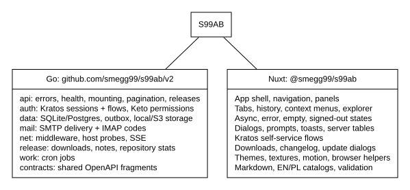

# S99AB

Shared application foundation for smegg99 apps.

S99AB ships a Go module and a Nuxt 4 layer as one versioned unit. Apps reuse the
same API conventions, persistence helpers, auth integration, background work,
storage, application shell and UI behaviour instead of rebuilding them.

```text
go.mod:       github.com/smegg99/s99ab/v2
nuxt.config:  extends: ['@smegg99/s99ab']
```

Built with Go 1.27, Gin, Nuxt 4, Vue 3, Vuetify 4 and Pinia Colada.

## Architecture



Diagram sources: [`docs/contents.dot`](docs/contents.dot).
Render with Graphviz: `dot -Tsvg docs/contents.dot -o docs/contents.svg`.

The [shared relationship graph](https://github.com/smegg99/S99Base/blob/main/docs/relations.svg)
shows how S99AB, S99Wails and S99Base connect.

| Boundary | Relationship | Source |
| --- | --- | --- |
| Go: `release/releases` | Imports S99Base `release/ghreleases`, `release/mdlocale`, `common/ttlcache` | [releases.go](release/releases/releases.go), [downloads.go](release/releases/downloads.go) |
| Nuxt: `/appearance` | Optional S99Wails bridge registers the OS theme/accent source | [appearance.ts](web/src/appearance.ts) |
| Nuxt: `/tabs` | Optional S99Wails bridge connects tabs to native windows | [tabs.ts](web/src/tabs.ts) |

The Go module requires S99Base v1.0.0. It has no S99Wails Go dependency, and the
Nuxt layer does not require a desktop runtime. A desktop app opts into the
bridges with S99Wails `frontendgen --s99ab`. The application owns startup,
domain routes, configuration, navigation, locale messages and feature UI.

## What is here

### Go

Package paths are relative to `github.com/smegg99/s99ab/v2`.

| Packages | Purpose |
| --- | --- |
| [`api/apierr`](api/apierr), [`api/apihealth`](api/apihealth), [`api/apimount`](api/apimount) | Error envelopes, health/readiness/version endpoints and Gin API group wiring. |
| [`api/apipage`](api/apipage), [`api/apiquery`](api/apiquery), [`api/apireleases`](api/apireleases) | Pagination/sort parsing, scalar query helpers and release endpoints. |
| [`auth/kratosauth`](auth/kratosauth), [`auth/kratosgin`](auth/kratosgin) | Kratos session resolution and Gin guards. |
| [`auth/kratosclient`](auth/kratosclient), [`auth/keto`](auth/keto) | Native Kratos API flows and Keto object permissions. |
| [`data/db`](data/db), [`data/outbox`](data/outbox) | SQLite/Postgres connections and migrations; transactional durable work with retries and dead letters. |
| [`data/storage`](data/storage) | Local/S3-compatible object storage, upload acceptance and image handling. |
| [`mail/mailer`](mail/mailer), [`mail/mailcatch`](mail/mailcatch) | SMTP delivery/templates and IMAP verification-code capture. |
| [`net/httpmw`](net/httpmw), [`net/netprobe`](net/netprobe), [`net/sse`](net/sse) | Rate/body-size limits, ICMP/TCP host probes and framework-free Server-Sent Events. |
| [`release/releases`](release/releases) | Cached application downloads, localized notes and repository stats. |
| [`work/jobs`](work/jobs) | In-process cron jobs without overlap; durable work belongs in `data/outbox`. |
| [`contracts`](contracts) | Shared OpenAPI schemas and parameters for app-owned contracts. |

[S99Base](https://github.com/smegg99/S99Base) provides application lifetime,
Unix-socket daemons, TTL caching, worker pools, GitHub releases and localized Markdown.

Version 2 uses the Go module path `github.com/smegg99/s99ab/v2`. The packages moved
to S99Base keep their relative paths; change those imports to
`github.com/smegg99/s99base/...`. The Nuxt package name remains `@smegg99/s99ab`.

### Nuxt

- Application shell, navigation, page and panel primitives.
- Loading, error, empty and signed-out states.
- Dialogs, prompts, confirms and toast queues.
- URL-synced server-side tables.
- Capability-driven file explorer.
- Workspace tabs, navigation history, pointer drag and context menus, with
  optional native window hooks.
- Ory Kratos self-service flow UI.
- Release/download/update UI: download card with planned and experimental
  platforms and fallback rows, changelog, release notice, repository counter,
  update and first-launch release-notes dialogs.
- Markdown rendering and lightweight syntax highlighting.
- Keyboard shortcuts, motion and auto-height transitions.
- Shared palettes, Vuetify defaults, textures, appearance preferences and
  build-time icon/font subsetting.
- Browser `EventSource` integration.
- English/Polish layer-localized strings and validation helpers.

The Go and Nuxt halves share the same error and pagination contracts and are
therefore released together.

## Quick start

If your checkout requires private-repository access, configure Go and Git for
an account with access:

```sh
go env -w GOPRIVATE='github.com/smegg99/*'
git config --global url."ssh://git@github.com/smegg99/".insteadOf "https://github.com/smegg99/"
```

Install the Go module:

```sh
go get github.com/smegg99/s99ab/v2
```

Consume the Nuxt layer from a sibling checkout:

```json
{
  "dependencies": {
    "@smegg99/s99ab": "link:../S99AB"
  }
}
```

```ts
export default defineNuxtConfig({
  extends: ['@smegg99/s99ab'],
})
```

## Subpaths

Inside a Nuxt app the layer auto-imports its `use*`, `provide*` and `dispose*`
composables and their types, nothing else. Plain functions, and code outside
Nuxt such as a desktop bridge, import from a subpath:

| Subpath | Holds |
|---|---|
| `@smegg99/s99ab/browser` | focus, pointer tracking and drag, tiles, edit undo, text fitting, `takeRow`, `createPendingSaves`, `prefersReducedMotion` |
| `@smegg99/s99ab/explorer` | tree helpers (`pathOf`, `groupByParent`, `childrenOf`, ...), `bindExplorerEvents`, `configureExplorer`, `applyExplorerTints`, `accentTriplet`, explorer types |
| `@smegg99/s99ab/kratos` | node helpers, `kratosRules`, `kratosMessageText`, `kratosSignOut`, `kratosRefreshSession`, sign-in routes (`isAuthFlowRoute`, `authFlowKind`, `resolveReturnTo`, ...), `configureAuthPaths`, Kratos types |
| `@smegg99/s99ab/appearance` | `useAppearance`, the appearance source, textures and `DEFAULT_PLANES`, the ground (`configureGround`, `applyGround`, `groundConfig`, `supportsWebgl`), `THEME_TRANSITIONS`, `originOf` |
| `@smegg99/s99ab/releases` | `formatBytes`, `kindKey`, `PLATFORM_NAMES`, `compareVersions`, `formatReleaseDate` |
| `@smegg99/s99ab/markdown` | `parseMarkdown`, `parseInline`, `tokenise` |
| `@smegg99/s99ab/state` | `settle`, `toApiError` |
| `@smegg99/s99ab/toast` | `configureToast`; showing toasts is `useToast()` |
| `@smegg99/s99ab/tabs` | `useTabs`, the tab context menu, native tab drag types |
| `@smegg99/s99ab/theme` | palettes and Vuetify theme helpers |
| `@smegg99/s99ab/types` | every type in a public signature |
| `@smegg99/s99ab/i18n` | the layer's catalogs |
| `@smegg99/s99ab/styles` | the shared stylesheet |

## Development

Use Go 1.27, a C compiler for the race detector, Node.js 24 or newer,
pnpm 11.3.0 and `just`. Install dependencies
with `pnpm install --frozen-lockfile`.

```sh
just check
just release-check
```

`check` verifies formatting without changing files, runs Go vet and race tests,
ESLint, Vue typechecking, Vitest, version and locale parity, contract linting and
package contents. Use `just fmt` or `just fix` to apply formatting.

`release-check` also needs Docker, Python 3, Xvfb and Chromium installed with
`pnpm exec playwright install chromium`. It creates disposable PostgreSQL,
SeaweedFS, Keto and Kratos containers on loopback ports, builds an SSR Nuxt consumer,
checks desktop/phone layouts in EN/PL and light/dark with normal/high contrast,
then runs dependency audits. No existing browser session is used. Browser
artifacts go to `$TMPDIR/s99ab-browser-results` (or `/tmp`); set
`S99AB_BROWSER_ARTIFACTS` to keep them elsewhere.

The stages can also run separately: `just test-services`, `just test-browser`
and `just audit`. Unit tests skip external services; `test-services` requires
them and fails if they are unavailable. Audits report all severities and fail
on unresolved advisories.

## License

MIT. See [LICENSE](LICENSE).
